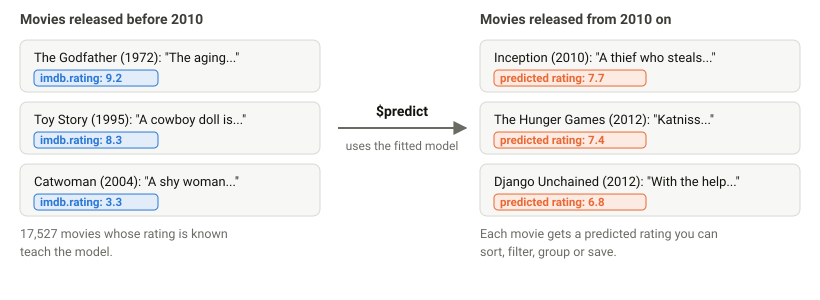
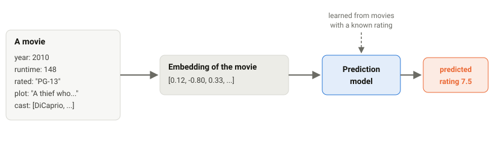
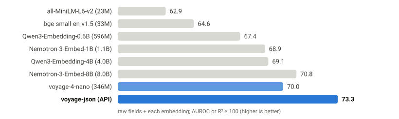

# Half the errors of Jev at a lower price

### Predicting missing fields in your MongoDB documents by learning from your data

**mongo-predict** (Python package `pymongopredict`) learns from the documents you already have and fills in a field for
the documents that lack it, such as a movie's rating or a new order's fraud flag. You fit a model once to your data,
then ask for predictions in an aggregation pipeline. By making use of your data (and a pre-trained embedding model), this gives you predictions that are **far more accurate than competitors like Jev**. We release both an open-source and an API option.

**Contents:** [1. What it does](#1-what-it-does) · [2. Quick start](#2-quick-start) ·
[3. How it works](#3-how-it-works) · [4. Results](#4-results) · [5. Recipes](#5-recipes) ·
[6. Good to know](#6-good-to-know) · [7. For data scientists: the embeddings API](#7-for-data-scientists-the-embeddings-api) ·
[Documentation, demos and development](#documentation-demos-and-development)

## 1. What it does

In many collections a field is set in some documents and missing in others. A new movie has no rating yet, and an
outcome is only known later. mongo-predict learns from the documents that have the field and predicts it for the
documents that do not (Fig. [1](#fig-1)). The examples use MongoDB's `sample_mflix.movies` collection, which is part of the
sample data you can load into any Atlas cluster.

<picture>
  <source media="(prefers-color-scheme: dark)" srcset="docs/figures/fig-1-dark.svg">
  
</picture>

<a id="fig-1"></a>**Figure 1.** Movies with a known rating (blue) teach the model; `$predict` adds a predicted rating (orange) to newer
movies. These are real ratings and predictions; the actual ratings of the newer movies are in Table [1](#tab-1).

The model reads every field you give it as text, so the plot, the list of genres, the cast and the directors count
as well as the year or the runtime (Sec. [4](#4-results)).

## 2. Quick start

Install the package from GitHub and connect to your database as usual:

```bash
pip install "pymongopredict @ git+https://github.com/voyage-ai/mongo-predict"
```

```python
from pymongo import MongoClient
from pymongopredict import PredictionModel, predictions_api

predictions_api.enable()   # lets coll.aggregate() understand $predict
movies = MongoClient("mongodb://localhost:27017").sample_mflix.movies

# 1. Fit a model once, to movies whose rating is known
movies.create_prediction_model(PredictionModel(
    {
        "target": "imdb.rating",                                       # the field to predict
        "embedFields": ["title", "year", "runtime", "rated",           # the fields to read
                        "genres", "cast", "directors", "plot"],
        "filter": {"year": {"$lt": 2010}},                             # learn from older movies
    },
    name="imdb_rating",
))

# 2. Use it in any aggregation pipeline
movies.aggregate([
    {"$predict": {"model": "imdb_rating", "filter": {"year": {"$gte": 2010}}}},
    {"$sort": {"p": {"$meta": "prediction"}}},       # best predicted first
    {"$limit": 10},
    {"$project": {"title": 1, "predicted_rating": {"$meta": "prediction"}}},
])
```

Fitting reads the movies, fits the model and stores it in your database (in a collection named
`__mongopredict_models`), together with how accurate it was on movies it did not see while fitting
(`movies.list_prediction_models()`). After that, any pipeline can start with `$predict`. The
[predictions API documentation](docs/pymongopredict/predictions_api.html) lists every setting of a model
(`PredictionModel`, `create_prediction_model`) and of the stage (`aggregate`).

## 3. How it works

Fig. [2](#fig-2) follows one movie through the model. A model cannot read a document directly, so the movie is first turned
into an **embedding**: a list of numbers produced by an embedding model, built so that documents with similar
meaning get similar numbers (two crime dramas end up closer to each other than to a children's cartoon). A
prediction model (XGBoost by default, or any scikit-learn estimator), learned once from the movies whose rating is
known, then turns these numbers into a rating.

The embedding model is chosen with `"embeddingModel"` in the model definition, and it can run in one of two places:

- **On your own machine.** The default, `"voyage-4-nano"`, is a small Voyage model that is downloaded once and runs
  locally, on a GPU if there is one. Any embedding model on Hugging Face works the same way, by its name (for example
  `"sentence-transformers/all-MiniLM-L6-v2"`). Your documents do not leave your machine.
- **Through the Voyage API.** Larger Voyage models (`"voyage-4"`, `"voyage-4-large"` and soon `"voyage-json"`) run on
  Voyage's servers and need no GPU. Set `VOYAGE_API_KEY` to a key from the [Voyage
  dashboard](https://dashboard.voyageai.com) (Sec. [5](#5-recipes) has an example).

<picture>
  <source media="(prefers-color-scheme: dark)" srcset="docs/figures/fig-2-dark.svg">
  
</picture>

<a id="fig-2"></a>**Figure 2.** A movie becomes an embedding, and the prediction model turns the embedding into a predicted rating.

## 4. Results

### One collection: movie ratings

We fit the model to the 17,527 movies released before 2010, predicted the IMDb rating of the 5,914 released from 2010 on,
and compared the predictions with the actual ratings.

- Always guessing the average rating of the older movies is off by 0.76 rating points on average.
- `$predict`, reading the title, year, runtime, age rating, genres, cast, directors and plot of each movie, is off by
  0.68 points on average, and predicts 78% of movies within one point of their actual rating (72% for the guess).
- Once the embeddings were computed, fitting took 79 seconds and `$predict` rated all 5,914 movies in
  8 seconds, on 16 CPU threads.

Table [1](#tab-1) shows the most voted recent movies. Most of their predictions are too low: a model fit to minimise the
average error rarely predicts extreme values, so movies rated far above average are underestimated.

<a id="tab-1"></a>**Table 1.** The eight most voted movies from 2010 on: actual and predicted IMDb ratings.

| Movie | Actual | Predicted |
|---|---|---|
| Inception (2010) | 8.8 | 7.7 |
| The Dark Knight Rises (2012) | 8.5 | 7.8 |
| The Avengers (2012) | 8.1 | 6.1 |
| Django Unchained (2012) | 8.5 | 6.8 |
| Interstellar (2014) | 8.7 | 8.0 |
| Shutter Island (2010) | 8.1 | 7.2 |
| The Hunger Games (2012) | 7.3 | 7.4 |
| The Wolf of Wall Street (2013) | 8.2 | 7.5 |

### Fifty collections

The same idea was tested on 50 real prediction tasks (MongoDB's sample data, a public benchmark of tables with text,
and datasets collected from the web), in a separate study that also trained Voyage embedding models for JSON
documents, called voyage-json. Adding the embedding of the whole document to the raw fields (no embedding model)
raised the average performance from 52.1 to 73.3 with voyage-json and to 70.0 with voyage-4-nano (the general Voyage
model mongo-predict uses by default, which runs on your own machine). Six embedding models not made by Voyage, from
23 million to 8 billion parameters, reach 62.9 to 70.8 (Fig. [3](#fig-3)). Counting the error as 100 minus the
performance, voyage-json makes 44% fewer errors than the raw fields, voyage-4-nano 37%, and the other models 23% to
39%.

<picture>
  <source media="(prefers-color-scheme: dark)" srcset="docs/figures/fig-3-dark.svg">
  
</picture>

<a id="fig-3"></a>**Figure 3.** Average performance over 50 tasks (AUROC for classification, R² for regression,
× 100; higher is better). Each bar adds that model's embedding of the whole document to the raw fields, which score
52.1 alone; bars start at 60 and parameter counts are in parentheses. mongo-predict uses voyage-4-nano by default and
can use any Voyage model; voyage-json is the model trained for JSON in that study.

### Compared with Jev

The same study compared against TypeSafe AI's Jev, a general model that labels documents without learning from your
own data, on the 29 tasks that predict a category. The score used is AUROC, which runs from 50 (no better than a coin
flip) to 100 (always right). Learning from the collection's own labelled documents with voyage-json scores 88.3
against Jev's 77.6, which is 48% fewer errors, at a slightly lower price per token ($0.040 per million tokens,
against $0.042) (Fig. [4](#fig-4)).

<picture>
  <source media="(prefers-color-scheme: dark)" srcset="docs/figures/fig-4-dark.svg">
  
</picture>

<a id="fig-4"></a>**Figure 4.** Accuracy and price against Jev on the 29 classification tasks of the same study. Jev needs no labelled
documents; learning from them means embedding those documents once (about $4 for a collection of 100 million
tokens with voyage-json).

<details>
<summary>Reproducing these results</summary>

- Fig. [1](#fig-1), the movie results in Sec. [4](#4-results) and Table [1](#tab-1): [`demos/predictions_api/movie_ratings.py`](demos/predictions_api/movie_ratings.py), run on
  `sample_mflix.movies` (23,441 movies with an IMDb rating and a release year) with voyage-4-nano embeddings; the
  results are in [`results/writeup_movies.json`](results/writeup_movies.json). The other ratings stored in the
  documents (Rotten Tomatoes, Metacritic, awards, IMDb votes) are not used. The prediction model is XGBoost (the
  default). The times are on 16 CPU threads, with a cache of embeddings computed beforehand (one GPU minute for all
  movies).
- Fig. [3](#fig-3): a Voyage study of the voyage-json models (50 evaluation tasks, 5,000 documents each, three random splits, ridge regression on
  the fields plus the embedding; performance is AUROC × 100 for classification and R² × 100 for regression, averaged
  over the tasks). The voyage-json performance numbers here and in Fig. [4](#fig-4) are those of voyage-json-lite in
  that study.
- Fig. [4](#fig-4): the same study (AUROC on its 29 classification tasks and prices per 1M tokens); 48% fewer errors is
  1 - (100 - 88.3) / (100 - 77.6).

</details>

## 5. Recipes

The predictions are part of a normal pipeline, so the usual stages work on them.

<details>
<summary><b>Rate the movies that have no rating and save the result</b></summary>

```python
movies.aggregate([
    {"$predict": {"model": "imdb_rating", "filter": {"imdb.rating": {"$not": {"$type": "number"}}}}},
    {"$project": {"predicted_rating": {"$meta": "prediction"}}},
    {"$merge": {"into": "movies", "on": "_id", "whenMatched": "merge"}},
])
```

</details>

<details>
<summary><b>Find the biggest surprises</b></summary>

```python
movies.aggregate([
    {"$predict": {"model": "imdb_rating",
                  "filter": {"year": {"$gte": 2010}, "imdb.rating": {"$type": "number"}}}},
    {"$set": {"surprise": {"$subtract": ["$imdb.rating", {"$meta": "prediction"}]}}},
    {"$sort": {"surprise": -1}},                  # rated much higher than expected
    {"$limit": 10},
    {"$project": {"title": 1, "imdb.rating": 1, "surprise": 1}},
])
```

</details>

<details>
<summary><b>Average predicted rating per genre</b></summary>

```python
movies.aggregate([
    {"$predict": {"model": "imdb_rating", "filter": {"year": {"$gte": 2010}}}},
    {"$set": {"predicted": {"$meta": "prediction"}}},
    {"$unwind": "$genres"},
    {"$group": {"_id": "$genres", "predicted": {"$avg": "$predicted"}, "movies": {"$sum": 1}}},
    {"$sort": {"predicted": -1}},
])
```

</details>

<details>
<summary><b>Use a Voyage API model instead of a local one</b></summary>

```python
# export VOYAGE_API_KEY=... first
movies.create_prediction_model(PredictionModel(
    {
        "target": "imdb.rating",
        "embedFields": ["title", "year", "runtime", "rated", "genres", "cast", "directors", "plot"],
        "embeddingModel": "voyage-4-lite",                 # or "voyage-4", "voyage-4-large", ...
        "embeddingKwargs": {"output_dimension": 1024},     # 256, 512, 1024 or 2048
        "filter": {"year": {"$lt": 2010}},
    },
    name="imdb_rating_api",
))
```

Requests are batched within the API's limits and retried with backoff when the rate limit is reached; `$predict`
embeds the new documents through the API as well.

</details>

<details>
<summary><b>Check, refit or remove a model</b></summary>

```python
movies.list_prediction_models("imdb_rating")    # status, settings, accuracy on held-out movies
movies.update_prediction_model("imdb_rating", {...new settings...})   # the old version keeps answering meanwhile
movies.drop_prediction_model("imdb_rating")
```

</details>

## 6. Good to know

- A model predicts a number or a category. With `"task": "auto"` (the default), a field of numbers with at least 8
  distinct values is predicted as a number, and anything else as a category.
- The model learns only from documents where the field is set. Its accuracy on documents it was not fit to is stored
  with it (`list_prediction_models`).
- Embedding is the slow step: about a minute for the 23,478 rated movies on one GPU, and much longer on a CPU. The
  embeddings are cached, so refitting on the same documents takes seconds.
- `$predict` runs from Python and must be the first stage of a pipeline. It reads the matching documents into your
  program, so use a filter or a limit on a large collection.
- It needs MongoDB 5.0 or later (tested on 5.0, 6.0, 7.0 and 8.0, and on Atlas; older servers get a clear error), and
  permission to create and drop collections in the database (for a temporary collection that holds the predictions).
- Models are stored in the `__mongopredict_models` collection and loaded by the programs that use them, so only
  trusted users should be able to write to it.

The predictions API documentation covers the rest: the [model definition](docs/pymongopredict/predictions_api.html#model-definition) (every setting),
[how a pipeline runs](docs/pymongopredict/predictions_api.html#how-a-pipeline-runs), and [details and limits](docs/pymongopredict/predictions_api.html#details-and-limits) (permissions,
signed models, views and time-series collections, cleanup of temporary collections, label types and missing values).

## 7. For data scientists: the embeddings API

`$predict` is built on an API in the style of scikit-learn that turns MongoDB documents into feature matrices. Use it
to choose the model yourself, to cross-validate, to add other features or to forecast time series. `MongoDataset`
points at a collection and indexes like an array, so scikit-learn's `train_test_split`, cross-validation splitters
and `cross_val_score` work on it directly; `DocumentFeaturizer` is a scikit-learn transformer that returns the
embedding of each document:

```python
from sklearn.linear_model import RidgeCV
from sklearn.model_selection import train_test_split
from pymongopredict import DocumentFeaturizer, MongoDataset

ds = MongoDataset(movies, target="imdb.rating", sort=[("released", 1)],          # oldest first
                  filter={"imdb.rating": {"$type": "number"}, "released": {"$type": "date"}})
ds_train, ds_test = train_test_split(ds, test_size=0.2, shuffle=False)          # newest 20% as test
prep = DocumentFeaturizer(
    embed_fields=["title", "year", "runtime", "rated", "genres", "cast", "directors", "plot"],  # None: everything
    embedding_model="voyage-4-nano",                                 # or another Voyage model
)
reg = RidgeCV().fit(prep.fit_transform(ds_train), ds_train.y)
reg.score(prep.transform(ds_test), ds_test.y)    # R² on the newest movies
```

The featurizer works in a `Pipeline`, accepts cursors and lists of documents, caches embeddings and can read
documents in batches. `MongoSeries` builds time series for sktime forecasters. A model behind `$predict` is this
featurizer plus a scikit-learn estimator, set with `"estimator"` in the model definition. The
[embeddings API documentation](docs/pymongopredict/embeddings_api.html) describes splits, featurizing, streaming,
forecasting and the embedding models.

## Documentation, demos and development

- **Documentation:** [`docs/`](docs/index.html) has one page for the package and one per API, built from the
  docstrings with `bash docs/build_docs.sh` (open `docs/index.html` in a browser).
- **Demos:** [`demos/`](demos/) runs each API on MongoDB's sample data; the
  [package documentation](docs/pymongopredict.html) lists them with their results.

  ```bash
  uv run python -m demos.load_sample_data --uri mongodb://localhost:27017 sample_mflix sample_airbnb sample_weatherdata
  uv run python -m demos.predictions_api.movie_ratings --uri mongodb://localhost:27017
  ```

- **Reports:** [`reports/`](reports/index.html) measures the speed of the embeddings API and the overhead and accuracy
  of `$predict`.
- **Development:**

  ```bash
  uv sync --all-extras --group dev
  uv run pytest -n 4                                              # tests on mongomock, no network or GPU needed
  MONGOPREDICT_TEST_URI=mongodb://localhost:27017 uv run pytest   # also the tests against a real server
  uv run ruff check .
  ```

## License

MIT
